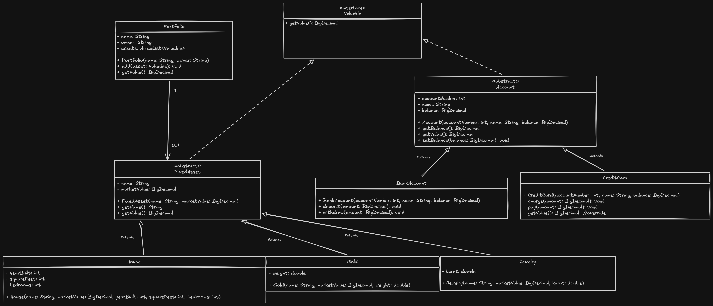

## Did the deposit work for both accounts? Why or why not?
It worked for account1 but not for account2. Because account1 is declared as a BankAccount, which has a deposit method while account2 is declared as a Valuable, and Valuable doesn't have deposit.

## What methods are available for account1?
Everything a BankAccount offers: deposit() and withdraw() from BankAccount, getBalance(), setBalance() and getValue() from Account.

## What methods are available for account2?
Only getValue(), which comes from the Valuable interface. Its deposit() and withdraw() methods exist on the object but can't be called through this Valuable.

## Why?
Java decides which methods you can call from the variable's declared type, not from the type of the object it points to.

# Portfolio implement Valuable
# Why does this make sense?

## Are the classes different kinds of things?
Yes. A portfolio is a collection while the others are single items. They aren't the same kind of thing, but they all have a value, so an interface fits better than a shared parent would.

## Would a shared parent be empty?
Yes. A parent for Portfolio and FixedAsset would have no shared fields it would just have getValue() which is what you use a interface for.

## Does a class need more than one ability, or already have a parent?
House and BankAccount already have parents, so they can't share another one. An interface lets them share getValue() anyway.

## What does it let a portfolio hold?
Portfolio can now hold other portfolios as well as houses, gold, bank accounts, and credit cards.